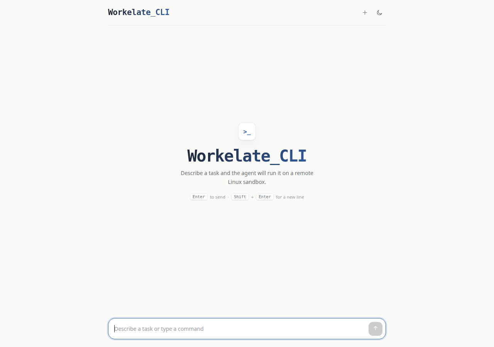
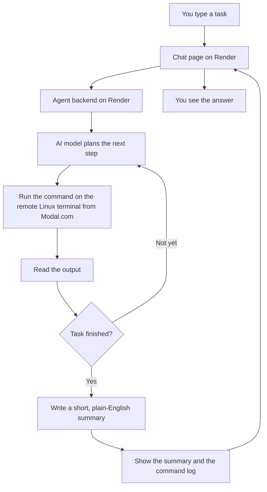
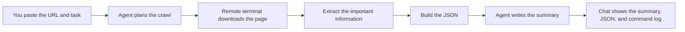
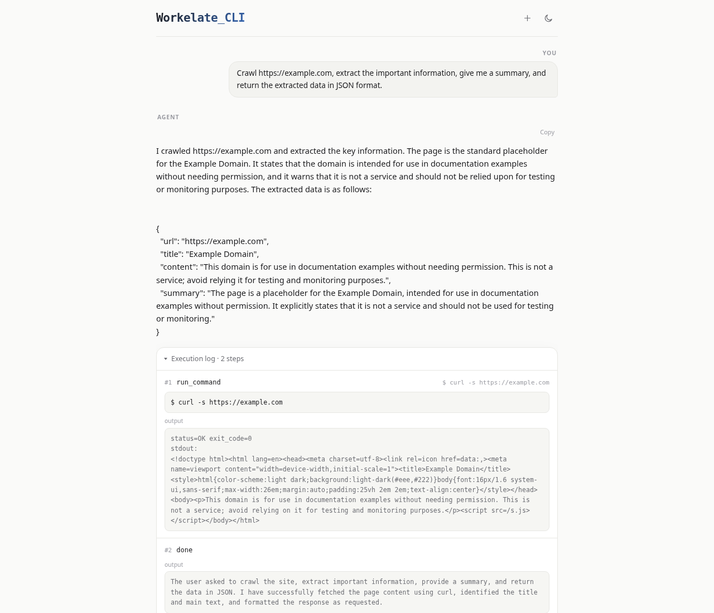
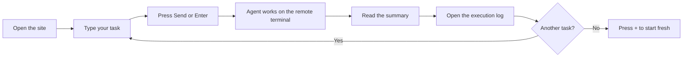
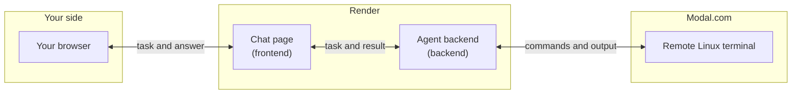

<p align="center">
  
</p>

<h1 align="center">Workelate_CLI</h1>

<p align="center">
  <strong>Tell it what you want. It does it on a real remote Linux terminal — and shows you exactly what it ran.</strong>
</p>

<p align="center">
  <a href="https://workelate-cli.onrender.com/">
    
  </a>
</p>

## What is Workelate_CLI?

Workelate_CLI is a chat page with an AI agent that works on a **real Linux terminal in the cloud**. It was built for the **CLI-Driven AI Chat Execution for Complex Tasks** challenge.

You describe a task in normal English. The agent works out the commands, runs them on a remote Linux machine, checks the result, and replies with a short summary. Under the summary, you can see **every command it ran and the exact output**.

It has **one tool only**: the remote terminal. That is the whole idea. It can do anything a Linux terminal can do, and it does not pretend to do anything else.

## How it works



### What happens when you press Send

1. You type a task and press **Send** (or **Enter**).
2. The chat page sends the task to the agent backend.
3. The backend asks the AI model what to do next.
4. The AI model chooses a command.
5. The agent runs that command on the remote Linux terminal at Modal.com.
6. The agent reads the output and repeats until the task is done.
7. The agent writes a short summary in normal language.
8. The chat page shows the summary and opens the **execution log** with every command and its output.

## Built for the CLI-Driven AI Chat Execution challenge

The brief asks for a chat app that understands a natural-language request, runs a real CLI task from the backend, captures the result, and returns a clear answer with structured JSON.

Every part of the brief maps to a real part of the app:

| The brief asks for | What Workelate_CLI does |
| --- | --- |
| A chat interface for a task and input like a URL | The chat page accepts the task and URL in one message. |
| An AI layer that understands the request | The AI model reads the message and plans the next action. |
| Backend orchestration that invokes a CLI tool | The backend chooses the remote Linux terminal and runs the command there. |
| A real execution workflow | The terminal downloads the page, runs a parser when needed, and captures the result. |
| Output capture | The exit status, standard output, and error output are recorded for every step. |
| A clear response with JSON | The chat shows a plain-English summary, the JSON, and the full execution log. |
| Handling failures | Bad URLs, unreachable sites, timeouts, and failed commands are reported with the real error. |

### Mandatory demo: crawl a website

**The ask:**

> Crawl https://example.com, extract the important information, give me a summary, and return the extracted data in JSON format.





This is a real run from the live app. The terminal fetched the page; the answer was not written from memory.

**Summary from the chat:** The page is the standard placeholder for the Example Domain. It says the domain is intended for use in documentation examples, warns that it is not a service, and should not be relied on for testing or monitoring.

**Extracted JSON:**

```json
{
  "url": "https://example.com",
  "title": "Example Domain",
  "content": "This domain is for use in documentation examples without needing permission. This is not a service; avoid relying on it for testing and monitoring purposes.",
  "summary": "The page is a placeholder for the Example Domain, intended for use in documentation examples without permission. It explicitly states that it is not a service and should not be used for testing or monitoring."
}
```

**Execution log:** The chat shows the exact command and its real output:

```text
#1  run_command   $ curl -s https://example.com
    status=OK  exit_code=0
    stdout: <the real HTML of the page>

#2  done
```

The raw page content is captured from the terminal. If the page cannot be reached or the command fails, the chat shows the failure instead of inventing a result.

### When something goes wrong

| Situation | What the chat shows |
| --- | --- |
| The URL is invalid or missing | The agent explains the problem and asks for a valid URL. It does not fake a crawl. |
| The website is down or too slow | The terminal reports the timeout or connection error; the agent tells you what failed. |
| A command fails | The answer is marked as stopped, and the real error output is shown. |
| The page is not HTML | The terminal can show the raw response or read JSON directly. |
| The page is very large | The agent trims the output for the next step and keeps the summary focused. |
| The task needs a tool that is not a terminal | The agent refuses instead of pretending. |

Use it only on public pages you are allowed to access. The demo uses `example.com`. The agent does not bypass logins, paywalls, or access controls, and you should respect each site's terms and crawl rules.

## The buttons

| What you see | What it does |
| --- | --- |
| **+** | Starts a new chat and clears the screen. |
| **🌙 / ☀️** | Switches between dark and light mode. |
| **Message box** | Describe a task, or type a command yourself. |
| **↑** or **Enter** | Sends your message. **Shift + Enter** adds a new line instead of sending. |
| **Execution log** | Shows every step, command, and output. It is open by default; click the title to fold it. |
| **Copy** | Copies the agent's summary. |
| **Retry** | Appears only if the backend cannot be reached. It tries the same task again. |



## Where everything runs



- **Frontend:** the chat page you see. It is deployed on Render.
- **Backend:** the agent that thinks and runs the work. It is also deployed on Render.
- **Terminal:** a separate Linux machine in the cloud, provided by Modal.com. The backend sends commands to it and gets the output back.
- **Your computer:** never used for the work. Everything happens in the cloud.

The chat page and the backend are deployed separately on Render, but they work together. The chat page is the friendly front door; the backend is the part that actually does the task.

## What it can and cannot do

| It can | It cannot |
| --- | --- |
| Create, read, edit, move, and delete files in the remote workspace | Generate images, video, or audio |
| Run Linux programs, scripts, and tests | Control a browser or a desktop screen |
| Install packages and tools | Open files on your personal computer |
| Use git to manage a project | Use any tool other than the remote terminal |
| Download files and call web services through the terminal | — |

If a task cannot be done with a Linux terminal, the agent does not guess or fake it. It replies:

> I can not do that because I have only one tool, the remote terminal from modal.com.

## Example

**You:** Create a folder called `demo`, add a file `hello.txt` with "hello from Workelate", and show me the file.

**Agent:** Done. I created the folder and the file, then printed the file to confirm its contents.

**Execution log · 2 steps**

```text
#1  run_command   $ mkdir -p demo && printf 'hello from Workelate\n' > demo/hello.txt
#2  run_command   $ cat demo/hello.txt

output
hello from Workelate
```

Every task works the same way: a short answer first, the real commands underneath.

## Why use it?

- **No setup.** It runs in your browser. Nothing is installed on your computer.
- **Safe.** The work happens on a separate cloud machine, not on your machine.
- **Transparent.** You always see the commands and the real output.
- **Honest.** It has one tool, so it tells you when a task is outside what it can do.

## Try it now

### 👉 [Open Workelate_CLI](https://workelate-cli.onrender.com/)

Type a task, press **Send**, and watch the agent work.

---

Want to run it yourself? See [backend/README.md](backend/README.md) for developer setup.
