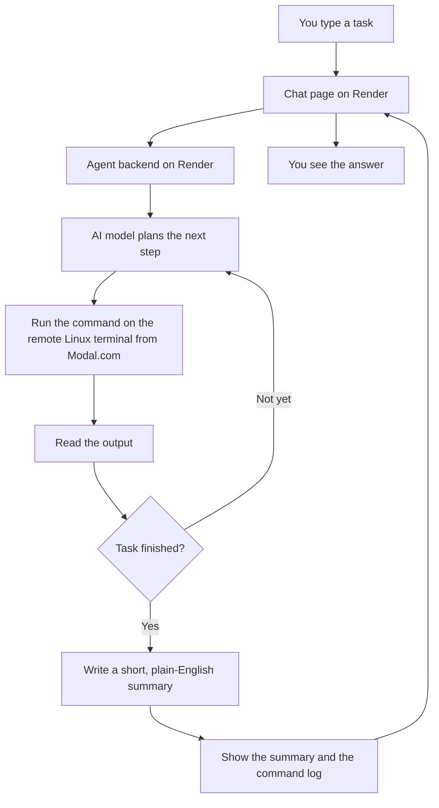
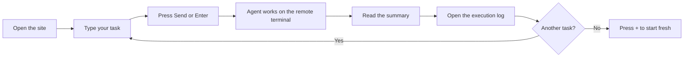
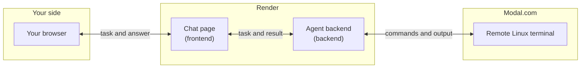

<p align="center">
  
</p>

<h1 align="center">Workelate_CLI</h1>

<p align="center">
  <strong>Tell it what you want. It does it on a real remote Linux terminal — and shows you exactly what it ran.</strong>
</p>

<p align="center">
  <a href="https://workelate-cli.onrender.com/">
    
  </a>
</p>

## What is Workelate_CLI?

Workelate_CLI is a chat page with an AI agent that works on a **real Linux terminal in the cloud**.

You describe a task in normal English. The agent works out the commands, runs them on a remote Linux machine, checks the result, and replies with a short summary. Under the summary, you can see **every command it ran and the exact output**.

It has **one tool only**: the remote terminal. That is the whole idea. It can do anything a Linux terminal can do, and it does not pretend to do anything else.

## How it works



### What happens when you press Send

1. You type a task and press **Send** (or **Enter**).
2. The chat page sends the task to the agent backend.
3. The backend asks the AI model what to do next.
4. The AI model chooses a command.
5. The agent runs that command on the remote Linux terminal at Modal.com.
6. The agent reads the output and repeats until the task is done.
7. The agent writes a short summary in normal language.
8. The chat page shows the summary and opens the **execution log** with every command and its output.

## The buttons

| What you see | What it does |
| --- | --- |
| **+** | Starts a new chat and clears the screen. |
| **🌙 / ☀️** | Switches between dark and light mode. |
| **Message box** | Describe a task, or type a command yourself. |
| **↑** or **Enter** | Sends your message. **Shift + Enter** adds a new line instead of sending. |
| **Execution log** | Shows every step, command, and output. It is open by default; click the title to fold it. |
| **Copy** | Copies the agent's summary. |
| **Retry** | Appears only if the backend cannot be reached. It tries the same task again. |



## Where everything runs



- **Frontend:** the chat page you see. It is deployed on Render.
- **Backend:** the agent that thinks and runs the work. It is also deployed on Render.
- **Terminal:** a separate Linux machine in the cloud, provided by Modal.com. The backend sends commands to it and gets the output back.
- **Your computer:** never used for the work. Everything happens in the cloud.

The chat page and the backend are deployed separately on Render, but they work together. The chat page is the friendly front door; the backend is the part that actually does the task.

## What it can and cannot do

| It can | It cannot |
| --- | --- |
| Create, read, edit, move, and delete files in the remote workspace | Generate images, video, or audio |
| Run Linux programs, scripts, and tests | Control a browser or a desktop screen |
| Install packages and tools | Open files on your personal computer |
| Use git to manage a project | Use any tool other than the remote terminal |
| Download files and call web services through the terminal | — |

If a task cannot be done with a Linux terminal, the agent does not guess or fake it. It replies:

> I can not do that because I have only one tool, the remote terminal from modal.com.

## Example

**You:** Create a folder called `demo`, add a file `hello.txt` with "hello from Workelate", and show me the file.

**Agent:** Done. I created the folder and the file, then printed the file to confirm its contents.

**Execution log · 2 steps**

```text
#1  run_command   $ mkdir -p demo && printf 'hello from Workelate\n' > demo/hello.txt
#2  run_command   $ cat demo/hello.txt

output
hello from Workelate
```

Every task works the same way: a short answer first, the real commands underneath.

## Why use it?

- **No setup.** It runs in your browser. Nothing is installed on your computer.
- **Safe.** The work happens on a separate cloud machine, not on your machine.
- **Transparent.** You always see the commands and the real output.
- **Honest.** It has one tool, so it tells you when a task is outside what it can do.

## Try it now

### 👉 [Open Workelate_CLI](https://workelate-cli.onrender.com/)

Type a task, press **Send**, and watch the agent work.

---

Want to run it yourself? See [backend/README.md](backend/README.md) for developer setup.
